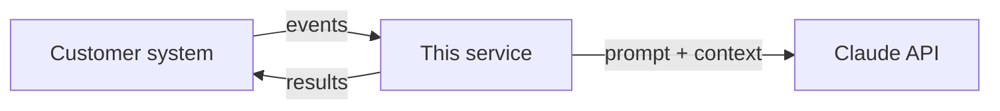

# <Project name>

> One sentence: what this does, for which fictional customer, and the outcome it improves.

Part of my Customer Engineer portfolio, built from
[ce-portfolio-template](https://github.com/hpk369/ce-portfolio-template).
All customer data is synthetic (Fernhollow Financial, Cedarline Health Network, Relaypoint).

## The problem

<!-- Two or three sentences in the customer's words: who is stuck, what it costs them today. -->

## Demo

- Live demo: <!-- link -->
- Video walkthrough (about 3 minutes): <!-- link -->

## Architecture

<!-- Replace with the context view only you can draw: the customer's systems, external APIs
     and this service, and what data crosses each arrow. -->



The code-level views (components, classes, call graph) are generated on every commit:
[docs/diagrams/architecture.md](docs/diagrams/architecture.md).

## Run it locally

```bash
cp .env.example .env                  # add this project's own API key
scripts/fetch-customer-data.sh        # synthetic customer profiles into data/
uv sync && uv run pytest              # or: npm ci && npm test
```

<!-- Then the one command that starts the demo, and what to click or send to see it work. -->

## Key decisions

| ADR | Decision |
| --- | --- |
| [0001](docs/adr/) | <!-- one line --> |

## Docs

- [Integration guide](docs/integration-guide.md): for the customer's engineers
- [Runbook](docs/runbook.md): for whoever is on call
- [Changelog](CHANGELOG.md) and [code diagrams](docs/diagrams/architecture.md)
- [How this repo is set up](docs/template-guide.md): Claude Code rules, CI and workflow

## What I'd do next

<!-- Three bullets: what you'd build with another month, and what a production rollout needs. -->
